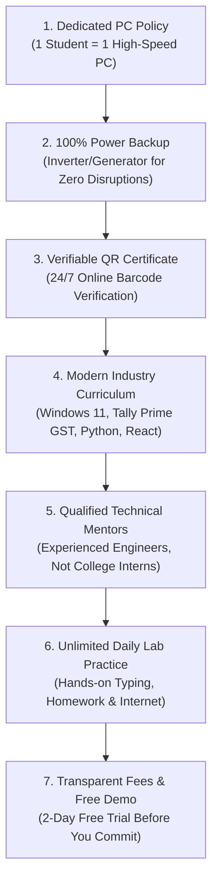

If you live in **Shikohabad, Firozabad, Jaswantnagar, Sirsaganj, or nearby areas in Uttar Pradesh**, learning computers is one of the most rewarding investments you can make for your future. Whether you want to clear government job eligibility (NIELIT CCC), learn accounting with Tally Prime GST, master graphic design, or start high-paying programming in Python and Full-Stack Web Development, having the right learning environment is critical.

However, choosing the right computer center can be tricky. Every coaching center claims to be the "No. 1 Computer Institute". But after enrolling, students often discover harsh realities:
- Three or four students forced to share a single slow computer screen.
- Power cuts disrupting classes for days with no generator or inverter backup.
- Outdated software (like Windows 7 or MS Office 2003) that has zero relevance in modern offices.
- Fake or unverified paper certificates that get rejected during government job document verification.

To protect your time, hard-earned money, and career aspirations, here is an essential **7-Point Quality Checklist** compiled by **Er. Sumit Kumar**, founder of MSK Institute, before you pay a single rupee of admission fees anywhere.

---

## The 7-Point Quality Checklist Before Joining Any Computer Institute

---

### 1. 100% "1 Student : 1 PC" Guarantee
Learning computers is like learning to drive a car—you cannot learn by sitting in the backseat watching someone else turn the steering wheel!
- **Ask Before Enrolling:** *"Will I get my own dedicated computer monitor, keyboard, and mouse for the full duration of my class batch?"*
- **The MSK Standard:** At MSK Institute, our lab policy is strict and uncompromising: **1 Student = 1 High-Speed PC**. No sharing screens, no taking turns.

### 2. Uninterrupted Power Backup
Load shedding and electricity cuts are a daily reality across Uttar Pradesh. If an institute lacks an automatic commercial inverter or silent generator, you will spend half your class hours sitting in dark classrooms.
- **The MSK Standard:** MSK Institute operates a heavy-duty inverter and power backup system. Your computer monitors and cooling systems run seamlessly with zero downtime during power cuts.

### 3. Lifetime Verifiable QR-Code Certificate
This is the most critical factor for students appearing for government recruitments (UP Police, Lekhpal, VDO, Railways, High Court):
- **The Risk:** Many roadside coaching centers hand out local printed paper certificates with no registration number. When government document verification officers check, these certificates are flagged as fake, disqualifying candidates.
- **The MSK Standard:** Every certificate issued by MSK Institute features an **encrypted QR Code and unique Roll Number**. Anyone, including employers or verification officers, can verify your certificate authenticity 24/7 directly on our official website at [mskinstitute.in/verify-certificate](/verify-certificate).

### 4. Modern Software & Up-to-Date Curriculum
Is the institute still teaching Paint, WordPad, and Windows 7? Modern offices and tech firms have moved to Windows 11, cloud storage, Google Workspace, Tally Prime with e-way billing, and modern programming tools.
- **The MSK Standard:** We teach on the latest Windows 11 workstations with **Tally Prime 4.0 GST**, Adobe Photoshop, CorelDraw, Python 3.12+, VS Code, and modern web frameworks.

### 5. Qualified & Experienced Technical Mentors
Who is teaching you? Is it an unguided student who completed the course last month, or a qualified software engineer?
- **The MSK Standard:** MSK Institute is founded and mentored by **Er. Sumit Kumar**, an experienced software engineer and technical educator with deep industry expertise in backend systems, databases, and full-stack architecture.

### 6. Free Lab Practice Hours & Typing Training
A 1-hour theoretical lecture is meaningless without dedicated practical application.
- **The MSK Standard:** Beyond regular lectures, our students enjoy free lab practice hours and access to our custom **[Hindi and English Typing Speed Portal](/tools/typing)** to help them achieve the 30–40 WPM speeds required in office and clerical exams.

### 7. Free Trial Demo Classes Before Paying Fees
Any reputable institute that is confident in its teaching quality and lab facilities will gladly invite you to experience classes before demanding admission fees.
- **The MSK Standard:** We offer **2 Days of 100% Free Demo Classes** with zero obligation. Attend classes, inspect our computers, talk to existing students, and experience the quality yourself.

---

## Comparison: Typical Computer Centers vs. MSK Institute Shikohabad

| Feature | Typical Local Computer Center | MSK Institute Shikohabad |
| :--- | :--- | :--- |
| **Lab Allocation** | 2 to 4 students per computer | **Guaranteed 1 Student : 1 PC** |
| **Power Supply** | Classes canceled during cuts | **Full Inverter & Generator Backup** |
| **Certificate Verification** | Paper only (Risk of rejection) | **Verifiable Online QR Code & Roll No.** |
| **Faculty Qualification** | Untrained junior instructors | **Led by Software Engineer Er. Sumit Kumar** |
| **Curriculum** | Outdated legacy syllabi | **Modern 2026 Industry-Ready Skills** |
| **Demo Class** | Demand fees on Day 1 | **2-Day Free Practical Demo Available** |
| **Free Typing & Online Tools** | Not available | **Integrated Online Tools & Practice Tests** |

---

## Popular Courses Taught at MSK Institute Shikohabad

1. **[ADCA (Advance Diploma in Computer Applications)](/courses/adca):** 1-Year comprehensive diploma covering Office Automation, Tally Prime GST, Graphic Design & Web Basics.
2. **[NIELIT CCC (Basic Computer Course)](/courses/ccc):** 3-Month government job certification with free online mock tests.
3. **[Python Programming Mastery](/courses/python-mastery):** Hands-on coding from syntax basics to automation and AI integration.
4. **[Data Analysis Mastery Combo Program](/courses/data-analysis-mastery-combo-course--12-months):** Excel, SQL, Power BI, and Python for high-paying analytics careers.
5. **[Full-Stack Web Development Grand Mastery](/courses/full-stack-development):** MERN, Django, Next.js, and cloud deployment.

---

## Visit MSK Institute Campus in Shikohabad

We invite all students, job aspirants, and parents to visit our campus, inspect our computer lab facilities, and meet our faculty:

- 📍 **Campus Address:**  
  **MSK Institute of Technology & Coding**  
  Gali No. 3, Near Gyan Jyoti Public School,  
  Station Road Area, Shikohabad,  
  Firozabad District, Uttar Pradesh – 283135
- 🕒 **Campus Timings:** Monday to Saturday: 8:00 AM – 7:00 PM | Sunday: 10:00 AM – 2:00 PM
- 📞 **Direct Contact / Helpline:** [+91 83930 42166](tel:+918393042166)
- 🗺️ **Google Maps Directions:** [Open MSK Institute on Google Maps](https://maps.google.com/?q=MSK+Institute+Shikohabad)

---

## Book Your Free 2-Day Demo Class Today

Don't settle for substandard computer training. Experience modern, practical, career-oriented education at Shikohabad's premier technology institute:

👉 **[Click Here to Book Your Free 2-Day Demo Class Online](/book-demo)**  
👉 **[Chat with Our Admission Counselor on WhatsApp](https://wa.me/918393042166?text=Hi%20MSK%20Institute,%20I%20want%20to%20visit%20your%20campus%20and%20book%20a%20free%20demo%20class.)**
