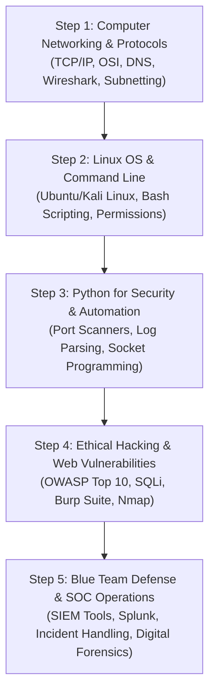

With rapid digitalization, nationwide UPI rollouts, and thousands of Indian enterprises moving their infrastructure to the cloud, cyber threats and ransomware attacks have hit record numbers in India. In response, government regulators (such as RBI, SEBI, and CERT-In) have mandated strict security compliance for banks, fintechs, hospitals, and IT companies.

This regulatory push has created an unprecedented talent shortage: **Demand for entry-level SOC (Security Operations Center) analysts and cybersecurity technicians in India is currently growing faster than any other IT job category**.

Yet, most students wrongly believe that entering cybersecurity requires a master's degree in cryptography or advanced math.

In reality, **ethical hacking and defensive security start with core networking, Linux commands, and hands-on lab curiosity**. Here is the complete, beginner-to-professional roadmap to kickstart your cybersecurity career in India in 2026.

---

## What Does an Entry-Level Cyber Security Professional Actually Do?

As a beginner in a corporate Security Operations Center (SOC) or IT security team, your daily responsibilities focus on:
- **Monitoring SIEM dashboards:** Reviewing real-time network alerts for suspicious logon attempts or port scans.
- **Triage & Incident Response:** Identifying whether an alert is a false alarm or a genuine malware intrusion.
- **Vulnerability Scanning:** Running automated vulnerability assessment tools against company servers to flag unpatched software.
- **Security Awareness:** Auditing employee access permissions and ensuring multi-factor authentication (MFA) is strictly enforced.

---

## The 5-Step Cyber Security Learning Roadmap



---

### Step 1: Computer Networking Fundamentals (Weeks 1–6)
You cannot protect a network you do not understand. Networking is 60% of all cybersecurity knowledge:
- **OSI & TCP/IP 4-Layer Models:** Understand how data packets traverse from an application to physical network cables.
- **Core Protocols:** `HTTP/HTTPS`, `DNS`, `DHCP`, `FTP`, `SSH`, `ARP`, and `ICMP`.
- **IPv4 vs IPv6 & Subnetting:** CIDR notation, public vs private IP ranges, and Network Address Translation (NAT).
- **Packet Analysis:** Using **Wireshark** to capture and inspect live packets, spotting plaintext credentials or DNS spoofing.

---

### Step 2: Linux Mastery & Command-Line Fluency (Weeks 7–12)
Over 90% of cloud servers and security appliances run on Linux. Beginners must become comfortable with the terminal:
- **Operating Systems:** Installing **Ubuntu** and **Kali Linux** in VirtualBox or VMware.
- **Essential Commands:** `grep`, `awk`, `sed`, `find`, `chmod`, `chown`, `systemctl`, `netstat`/`ss`, and `iptables`.
- **Bash Scripting:** Automating routine tasks such as checking open ports and parsing server logs for failed SSH logins.

---

### Step 3: Python for Security Automation (Weeks 13–18)
Python is the ultimate Swiss Army knife for cybersecurity analysts. You don't need to build large web apps; focus on security scripting:
- Writing automated port scanners with Python's `socket` library.
- Parsing gigabytes of Apache/Nginx web logs using regex to identify brute-force attacks.
- Interacting with threat intelligence APIs (VirusTotal, AbuseIPDB).

```python
# Simple Python Port Scanner Example
import socket

target_ip = "127.0.0.1"
common_ports = [21, 22, 80, 443, 3306]

for port in common_ports:
    s = socket.socket(socket.AF_INET, socket.SOCK_STREAM)
    s.settimeout(1.0)
    result = s.connect_ex((target_ip, port))
    if result == 0:
        print(f"[+] Port {port} is OPEN")
    s.close()
```

---

### Step 4: Ethical Hacking & Web Application Security (Weeks 19–26)
Learn how adversaries think so you can defend against them:
- **Reconnaissance & Scanning:** Discovering network perimeters with `Nmap` and `Masscan`.
- **OWASP Top 10 Web Vulnerabilities:**
  - SQL Injection (SQLi)
  - Cross-Site Scripting (XSS)
  - Broken Access Control & IDOR
  - Cross-Site Request Forgery (CSRF)
- **Hands-on Interception:** Configuring **Burp Suite Community** to proxy HTTP requests and manipulate web parameters.

---

### Step 5: SOC Operations & Blue Team Defense (Weeks 27–36)
This is where the direct jobs are:
- **SIEM (Security Information & Event Management):** Working with industry tools like **Splunk**, **Wazuh**, or **ELK Stack**.
- **Incident Handling (NIST/SANS):** Preparation, Identification, Containment, Eradication, Recovery, and Lessons Learned.
- **Digital Forensics:** Memory analysis with Volatility, examining USB logs, and analyzing phishing email headers.

---

## Cyber Security Salary Trends in India (2026)

Because cybersecurity roles directly protect corporate assets and financial transactions, compensation packages are exceptionally strong:

| Job Role | Experience | Annual CTC (INR) |
| :--- | :--- | :--- |
| **SOC Analyst (L1) / Security Associate** | 0 – 2 Years | **₹4.5 LPA – ₹8.0 LPA** |
| **VAPT / Ethical Hacking Consultant** | 1 – 3 Years | **₹6.5 LPA – ₹12.0 LPA** |
| **SOC Analyst (L2/L3) / Incident Responder** | 3 – 5 Years | **₹10.0 LPA – ₹18.0 LPA** |
| **Information Security Manager / CISO** | 7+ Years | **₹22.0 LPA – ₹45.0+ LPA** |

---

## Certifications That Actually Help Freshers in India

While hands-on lab projects matter most, having industry certifications helps get your resume past HR filters:
1. **MSK Institute Cyber Security & Ethical Hacking Diploma:** Comprehensive practical diploma with instant verifiable QR verification.
2. **CompTIA Security+:** The world's most recognized vendor-neutral foundational security credential.
3. **Certified Ethical Hacker (CEH) / Practical Network Penetration Tester (PNPT):** Demonstrates hands-on assessment capability.

---

## Start Your Cyber Security Career at MSK Institute

Are you ready to defend networks and stop digital adversaries? At **MSK Institute**, our students train in isolated security labs, configure real firewall rules, simulate penetration tests, and analyze live SIEM logs.

- **Explore the Program:**  
  👉 **[Cyber Security & Ethical Hacking Professional Program (18 Months)](/courses/cyber-security-ethical-hacking-professional-program)**  
  Covering hardware, networking, Linux, Python, penetration testing, Active Directory, cloud security, and SOC operations.

- **Experience the Lab Firsthand:**  
  Visit our campus in Shikohabad or attend online:  
  👉 **[Book a Free In-Person Demo Class](/book-demo)**

- **Explore Everyday Cyber Hygiene:**  
  Read our companion guide on [Demystifying Cyber Security: 7 Essential Habits to Protect Your Digital Life](/blogs/demystifying-cyber-security-7-habits-to-protect-digital-footprint).
