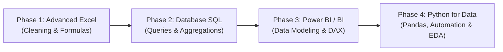

Every modern business in India—from retail supermarkets and private hospitals to e-commerce startups, banking institutions, and manufacturing plants—generates massive oceans of operational numbers every single day. Yet, most of this data sits unused because companies lack professionals who can clean it, analyze it, and turn it into **profitable business decisions**.

This talent gap is why **Data Analytics professionals in India typically earn between ₹5 LPA to ₹15 LPA**, making it one of the most rewarding and accessible tech careers today.

The best part? **You do not need a B.Tech in Computer Science, advanced calculus, or years of coding experience.** Students from B.Com, B.A., B.Sc, BCA, BBA, and non-tech working backgrounds routinely transition into high-paying analytics roles within 6 to 9 months of disciplined, hands-on practice.

Here is the definitive step-by-step 2026 roadmap: **Excel → SQL → Power BI → Python**, formulated by **Er. Sumit Kumar** at MSK Institute.

---

> 📥 **Want This Complete Roadmap as a Handy Downloadable Guide?**  
> Send a quick message to our counselor desk on WhatsApp and get the **Free Data Analyst Roadmap 2026 PDF**:  
> 👉 **[Click Here to Get Free Roadmap PDF on WhatsApp](https://wa.me/918393042166?text=Hi%20MSK%20Institute,%20please%20send%20me%20the%20Free%20Data%20Analyst%20Roadmap%202026%20PDF%20guide.)** *(Direct delivery to your WhatsApp chat)*

---

## The 4-Phase Tech Stack Roadmap



---

### Phase 1: Advanced Excel & Business Analytics (Weeks 1–4)

Never underestimate Microsoft Excel. Over 70% of business reporting in India still originates in spreadsheets:

- **Must-Master Formulas:** `XLOOKUP`, `INDEX/MATCH`, `SUMIFS`, `COUNTIFS`, `IFERROR`, `UNIQUE`, `FILTER`.
- **Data Hygiene & Cleaning:** Text-to-Columns, removing duplicate entries, trimming trailing whitespaces, and handling null/blank values.
- **Pivot Tables & Slicers:** Grouping dates into Quarters and Fiscal Years, calculating Year-over-Year (YoY) percentage changes, and building interactive summary boards.
- **Capstone Goal:** Build an automated monthly revenue calculator that updates with 1-click refresh when new raw sales sheets are pasted.

---

### Phase 2: Relational Databases & SQL (Weeks 5–10)

SQL (Structured Query Language) is the single most tested technical skill in every data analyst interview. If you master SQL, you will sail through technical screening rounds.

```sql
-- Sample Interview Query: Find top 3 highest spending customers by month
WITH MonthlySpend AS (
    SELECT 
        customer_id,
        DATE_TRUNC('month', order_date) AS order_month,
        SUM(order_amount) AS total_spent,
        DENSE_RANK() OVER (
            PARTITION BY DATE_TRUNC('month', order_date) 
            ORDER BY SUM(order_amount) DESC
        ) AS rank_in_month
    FROM orders
    WHERE order_status = 'Delivered'
    GROUP BY customer_id, DATE_TRUNC('month', order_date)
)
SELECT * FROM MonthlySpend WHERE rank_in_month <= 3;
```

#### Core SQL Topics to Target:
1. **Filtering & Aggregation:** `SELECT`, `WHERE`, `GROUP BY`, `HAVING`, `ORDER BY`.
2. **Joins:** `INNER JOIN`, `LEFT JOIN`, `RIGHT JOIN`, `FULL OUTER JOIN`, and resolving complex relationships.
3. **Subqueries & Common Table Expressions (CTEs):** Writing readable, modular query blocks using `WITH`.
4. **Window Functions:** `ROW_NUMBER()`, `RANK()`, `DENSE_RANK()`, `LEAD()`, `LAG()`.

---

### Phase 3: Business Intelligence with Power BI & DAX (Weeks 11–16)

Company executives don't read raw SQL tables; they inspect dynamic, visual management dashboards. Power BI is currently the most demanded BI tool across Indian and global enterprises.

- **Power Query:** Extracting, Transforming, and Loading (ETL) data from CSVs, SQL databases, and web sources.
- **Data Modeling:** Creating clean **Star Schema** models with one-to-many relationships between Fact tables and Dimension tables.
- **DAX (Data Analysis Expressions):** Writing calculated business metrics such as:
  ```dax
  YoY Sales Growth % = 
  DIVIDE(
      [Total Revenue] - [Previous Year Revenue],
      [Previous Year Revenue],
      0
  )
  ```
- **Dashboard Storytelling:** Designing executive dashboards with custom KPI cards, trend sparklines, and drill-through drill-downs.

---

### Phase 4: Python for Automation & Exploratory Data Analysis (Weeks 17–24)

When datasets exceed Excel's 1-million-row limit or when you need automated daily report generation, Python is your superpower:

- **Pandas:** Loading datasets (`pd.read_csv`), filtering columns, groupby aggregations, and merging disparate data frames.
- **NumPy:** Vectorized numerical operations and multi-dimensional matrix operations.
- **Visual Analytics:** Plotting statistical correlations using Matplotlib and Seaborn heatmaps.
- **Automation Scripts:** Writing scripts that pull database records, clean inconsistencies, generate PDF summaries, and email them automatically.

Test code snippets directly inside our browser-based [MSK Code Playground](/playground)!

---

## 3 Portfolio Projects That Guarantee Recruiter Interviews

Having a GitHub and Power BI NovyPro portfolio with real-world case studies beats any resume credential:

1. **E-Commerce Customer Churn Analysis:**  
   Analyze 50,000 order transactions to identify which customer cohorts stop ordering after 90 days.  
   *Tech Stack:* SQL + Power BI + Python.

2. **Financial Bank Loan Default Prediction Dashboard:**  
   Visual dashboard highlighting non-performing asset (NPA) risks based on credit score, annual income, and debt-to-income ratio.  
   *Tech Stack:* Excel + Power BI + DAX.

3. **Retail Supply Chain & Inventory Optimization:**  
   Track stock-out rates, supplier lead times, and warehouse turnover rates across multi-city store branches.

---

## Data Analyst Salary Expectations in India (2026)

| Experience Level | Annual CTC Range (INR) | Primary Job Roles |
| :--- | :--- | :--- |
| **Fresher / Entry-Level** | **₹5.0 LPA – ₹7.5 LPA** | Junior Data Analyst, MIS Executive, BI Trainee |
| **Mid-Level (2–4 Years)** | **₹8.0 LPA – ₹15.0 LPA** | Data Analyst, BI Developer, Product Analyst |
| **Senior / Lead (5+ Years)** | **₹16.0 LPA – ₹28.0+ LPA** | Analytics Manager, Lead BI Consultant, Data Strategist |

---

## Next Steps: Join the 1 Nov Data Analysis Mastery Batch

Transitioning into Data Analytics does not require genius math abilities; it requires consistent, hands-on practice on real business datasets under mentor guidance.

- **Upcoming Data Analysis Mastery Batch (Starts 1 Nov):**  
  Our signature program covers Excel, SQL, Power BI, and Python with 10+ live enterprise case studies, portfolio building, and 1-on-1 interview preparation.  
  👉 **[Explore Full 12-Month Data Analysis Course](/courses/data-analysis-mastery-combo-course--12-months)**

- **Free Roadmap PDF on WhatsApp:**  
  👉 **[Click Here to Receive the Free Roadmap PDF via WhatsApp](https://wa.me/918393042166?text=Hi%20MSK%20Institute,%20please%20send%20me%20the%20Free%20Data%20Analyst%20Roadmap%202026%20PDF%20guide.)**

- **Live Batches & Free Demo Classes:**  
  Check real-time batch schedules at our **[Live Batches Portal](/live-batches)** or **[Book a Free Demo Class](/book-demo)** at MSK Institute Shikohabad!
