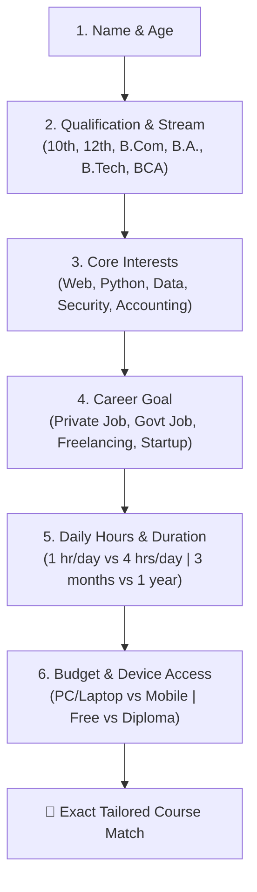
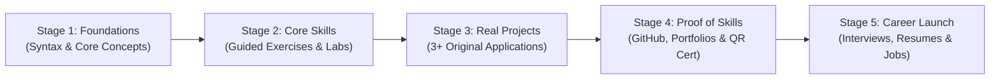

Every month, hundreds of students visit **MSK Institute** or message our admission desk asking the exact same question:

> *"Sir, mujhe computer me career banana hai, lekin samajh nahi aa raha ki kaun sa course karun? Kya mujhe Python sikhna chahiye, Full-Stack Web Development karna chahiye, Data Analytics me jana chahiye, Cyber Security chuni chahiye, ya 1-year ADCA diploma best rahega?"*

Choosing the wrong course is expensive—not just in terms of admission fees, but in **months of wasted time, lost confidence, and frustration**. Most students pick courses based on whatever their friends are doing, or whatever flashy Instagram ad caught their attention, without considering:
- Their current educational background (Arts, Commerce, Science, BCA, B.Tech, or 12th pass).
- How much daily time they can realistically dedicate (1 hour vs 4 hours).
- Their practical hardware availability (high-spec laptop vs smartphone only).
- Their ultimate career goal (government job, corporate MNC, startup, freelancing, or family business).

To solve this dilemma once and for all, **Er. Sumit Kumar** and the mentorship team at MSK Institute developed the **MSK AI Career Guidance & Course Recommendation Framework**. 

In this comprehensive guide, we walk you through the exact **12-point self-assessment interview**, evaluate the **6 core computer career directions**, provide a **stream-wise decision matrix**, and show you how to find your personalized learning roadmap today.

---

> 🎯 **Want an Instant AI Recommendation in 2 Minutes?**  
> Skip the manual calculation and let our interactive diagnostic quiz analyze your profile:  
> 👉 **[Take the Free MSK Career Finder Quiz Now](/career-finder)**

---

## Phase 1: The 12-Point Student Profile Self-Assessment

Before jumping into any course syllabus, answer these 12 questions honestly. Your answers will instantly eliminate 80% of unsuitable courses and highlight your highest-probability career path.

### 1. Name & Age
- **Why it matters:** Educational goals shift with age. A 16-year-old high school student needs foundational logic and creative projects, while a 22-year-old college graduate needs fast-track job-ready technical skills and resume-worthy capstones.

### 2. Current Qualification & Academic Stream
- **Class 10th or 12th (Arts / Humanities):** Focus on foundational computing, typing speed, and [NIELIT CCC](/courses/ccc) or [ADCA Diploma](/courses/adca).
- **Class 12th (Commerce) or B.Com / BBA:** Natural synergy with **Tally Prime GST Accounting** and **Data Analytics (Excel + SQL + Power BI)**.
- **Class 12th (PCM / Science) or BCA / B.Tech / B.Sc IT:** Ready for high-earning software pathways like [Python Mastery](/courses/python-mastery), [Full-Stack Development](/courses/full-stack-development), or [Cyber Security](/courses/cyber-security-ethical-hacking-professional-program).

### 3. Your Genuine Computer Interests
Do you enjoy:
- **Visual Creativity & User Interfaces?** → Web Design, Frontend Development, UI/UX.
- **Mathematical Logic & Business Numbers?** → Data Analytics, SQL Databases, Power BI.
- **Problem Solving & Automation?** → Python Programming, Backend Engineering, AI Integration.
- **Puzzles, Defense & System Administration?** → Cyber Security, Ethical Hacking, Linux Networking.
- **Day-to-Day Office Operations & Taxation?** → Advanced MS Office, Tally Prime GST, DTP.

### 4. Primary Career Goal
- **Immediate Private Job (3–6 Months):** Focus on high-demand execution skills (Python Developer, MIS Executive, Junior Web Developer).
- **Government Job Preparation (UP Police, Lekhpal, VDO, Railways):** Mandatory requirement for **[NIELIT CCC Certification](/courses/ccc)** and typing speed (30+ WPM).
- **Work-From-Home / Freelancing:** Full-Stack Web Development, WordPress/Shopify design, Python web scraping, or Graphic Design.
- **Long-Term High-Salary IT Career (₹6–15+ LPA):** Comprehensive [12-Month Data Analysis](/courses/data-analysis-mastery-combo-course--12-months) or [18-Month Full-Stack Grand Mastery](/courses/full-stack-development).

### 5. Prior Experience & Existing Skills
- **Complete Beginner (Zero Knowledge):** Start with computer fundamentals, typing, and visual tools before complex syntax.
- **Knows Basic Office / HTML:** Ready to accelerate directly into Python, modern JavaScript, or SQL database querying.

### 6. Daily Learning Time Available
- **30 to 60 Mins/Day:** Best for modular short courses (CCC, Python Basics, Advanced Excel).
- **2 to 4+ Hours/Day:** Ideal for immersive career cohorts (Full-Stack Bootcamp, Data Analytics Combo, Ethical Hacking).

### 7. Realistic Course Timeline
- **1 to 3 Months:** Certification crash courses, Python fundamentals, CCC.
- **6 to 12 Months:** Comprehensive diplomas (ADCA, 12-Month MERN / Python Django cohorts).
- **18 Months:** End-to-end multi-stack architectural programs.

### 8. Budget Expectations
- **Free Only:** High-quality verified YouTube tutorials, open-source documentation, and the [MSK Free Code Playground](/playground).
- **Budget-Friendly Certification (₹1,000–₹5,000):** Targeted skill modules, CCC exam preparation batches.
- **Professional Diplomas with Lab Workstation (₹8,000–₹25,000):** Full offline practical lab training with 1-student-1-PC, live project reviews, and permanent [QR-code verified credentials](/verify-certificate).

### 9. Learning Mode (Offline Lab vs Online Live)
- If you live in or near Shikohabad/Firozabad, an **offline physical lab** with high-speed internet, dedicated workstation, and power backup is unmatched for discipline.
- If you live elsewhere or work full-time, **interactive online live batches** with screen-sharing and recorded archives offer optimal flexibility.

### 10. Device Availability (Laptop vs Smartphone)
- **Have a Laptop/Desktop:** You can practice any course immediately (coding IDEs, virtual machines, Power BI Desktop, Tally Prime).
- **Smartphone Only:** Do not be discouraged! You can learn Python and JavaScript fundamentals using our zero-install [MSK Code Playground](/playground), take online mock tests, and practice theory before booking lab hours at our institute.

---

## Phase 2: The 6 Core IT Career Directions Compared

Here is an objective, head-to-head comparison of the six main career tracks taught at MSK Institute:

| Rank & Track | Core Technologies | Target Job Roles | Ideal Duration | Level | Salary Scope in India (2026) | Top Verified Course |
| :--- | :--- | :--- | :--- | :--- | :--- | :--- |
| **1. Full-Stack Web Dev** | HTML5, Tailwind, React, Node.js / Django, PostgreSQL | Full-Stack Engineer, Frontend Dev, React Specialist | 12–18 Months | Beginner to Advanced | **₹5.0 – ₹14.0 LPA** | **[Full-Stack Grand Mastery](/courses/full-stack-development)** |
| **2. Python & AI Foundations** | Python 3, OOP, SQLite, REST APIs, Automation | Junior Python Dev, Automation Trainee, AI Associate | 3–6 Months | Beginner | **₹4.5 – ₹9.0 LPA** | **[Python Mastery Course](/courses/python-mastery)** |
| **3. Data Analytics & BI** | Advanced Excel, SQL, Power BI, DAX, Python Pandas | Data Analyst, BI Developer, MIS Executive | 6–12 Months | Beginner to Intermediate | **₹5.0 – ₹15.0 LPA** | **[Data Analysis Combo](/courses/data-analysis-mastery-combo-course--12-months)** |
| **4. Cyber Security & SOC** | Networking, Linux, Wireshark, Burp Suite, Python, SIEM | SOC Analyst L1, Ethical Hacker, Security Admin | 12–18 Months | Beginner to Advanced | **₹5.0 – ₹16.0 LPA** | **[Cyber Security Program](/courses/cyber-security-ethical-hacking-professional-program)** |
| **5. Office & Accounting (ADCA)**| MS Office, Tally Prime GST, Photoshop, CorelDraw | Accounts Assistant, Office Admin, DTP Designer | 12 Months | Beginner | **₹18,000 – ₹35,000/mo** | **[ADCA 1-Year Diploma](/courses/adca)** |
| **6. Govt Exam Readiness (CCC)**| LibreOffice, Operating Systems, Digital Finance, Cyber | UP Police, Lekhpal, VDO, Clerical Posts | 2–3 Months | Beginner | Govt Pay Scale (Level 3–5) | **[NIELIT CCC Course](/courses/ccc)** |

---

## Phase 3: Which Course Wins What? (Special Categories)

To make your decision even easier, here is the breakdown by specific student requirements:

### ⭐ Best Overall Match for Tech Careers: Python Programming Mastery
- **Why:** Python has the gentlest learning curve, English-like syntax, and opens doors to Web Development, Data Analytics, and AI. If you are unsure where to start in coding, **start with Python**.
- 👉 **[Explore Python Mastery (Starts 1 Nov)](/courses/python-mastery)**

### 💰 Best Budget & All-Rounder Option: 1-Year ADCA Diploma
- **Why:** Covers 4 vital commercial skill sets in a single course: Office Automation, Advanced Excel, Tally Prime GST, and Graphic Design. Gives immediate employability in private offices and business markets.
- 👉 **[Explore ADCA 1-Year Diploma](/courses/adca)**

### ⚡ Best Short-Duration Option (Under 3 Months): NIELIT CCC
- **Why:** Mandatory certificate for Uttar Pradesh government jobs. Can be completed in 60 to 90 days with daily practice on our [Free Online CCC Mock Test](/mock-test/ccc).
- 👉 **[Explore NIELIT CCC Program](/courses/ccc)**

### 🚀 Best High-Salary Growth Track: Data Analysis Mastery Combo
- **Why:** Businesses are drowning in numbers. Professionals who know how to query databases with SQL, build dashboards in Power BI, and clean data with Python command premium salaries without needing a CS degree.
- 👉 **[Explore 12-Month Data Analysis Combo](/courses/data-analysis-mastery-combo-course--12-months)**

### 🛡️ Best for Tech Enthusiasts Who Love Defense: Cyber Security & Ethical Hacking
- **Why:** Rapid expansion of digital banking and strict compliance laws have created a massive shortage of entry-level SOC analysts in India.
- 👉 **[Explore Cyber Security & Ethical Hacking Program](/courses/cyber-security-ethical-hacking-professional-program)**

---

## Phase 4: The 5-Stage Universal Learning Roadmap

Regardless of which course you pick, following this proven 5-stage progression guarantees genuine hiring readiness:

1. **Stage 1 (Foundations):** Master terminal basics, clean syntax, and fundamental logic. Test small snippets on [MSK Code Playground](/playground).
2. **Stage 2 (Hands-on Labs):** Spend 70% of your time typing code or configuring software rather than passively watching video lectures.
3. **Stage 3 (Practical Projects):** Build 3 real-world capstone projects. For example, if learning Python, build projects from our guide on [10 Python Projects for Beginners to Put on Your Resume](/blogs/10-python-projects-for-beginners-resume-github-code).
4. **Stage 4 (Proof of Skill):** Push your code to GitHub with descriptive README files and verify your official credentials at [MSK Certificate Verification](/verify-certificate).
5. **Stage 5 (Career Launch):** Craft a tailored resume highlighting your projects, practice technical viva questions, and attend job interviews with confidence.

---

## Free Immediate First Step: Test Before You Commit

You don't have to spend any money today to begin your journey:

1. **Test Your Coding Logic in Browser:**  
   Launch our zero-install code editor right now:  
   👉 **[Open MSK Code Playground](/playground)**

2. **Test Your Typing Speed:**  
   Measure your Hindi and English WPM speed:  
   👉 **[Launch Online Typing Speed Tool](/tools/typing)**

3. **Take the 2-Minute Career Quiz:**  
   Answer 5 quick questions to get an automated course recommendation:  
   👉 **[Start Free Career Finder Quiz](/career-finder)**

---

## Summary & Next Step: Talk to an Academic Counselor

Still confused between two options (e.g., *MERN vs Django* or *ADCA vs Python*)? 

At **MSK Institute in Shikohabad**, we believe in honest, pressure-free academic counseling. We never force students into expensive courses that don't match their career goals.

- 🏫 **Visit Our Campus:**  
  Gali No. 3, Near Gyan Jyoti Public School, Station Road Area, Shikohabad (Firozabad District, UP).
- 💻 **Book a Free 2-Day Practical Demo:**  
  Sit in a real class, inspect our 1-student-1-PC lab workstation, and experience our teaching firsthand:  
  👉 **[Book Your Free 2-Day Demo Class Online](/book-demo)**
- 📱 **Chat Directly on WhatsApp:**  
  Have a quick question about course fees, batch timings, or syllabus?  
  👉 **[Chat with Er. Sumit Kumar on WhatsApp](https://wa.me/918393042166?text=Hi%20Er.%20Sumit%20Kumar,%20I%20read%20the%20Career%20Guidance%20guide%20and%20want%20help%20choosing%20the%20best%20computer%20course%20for%20my%20profile.)**
