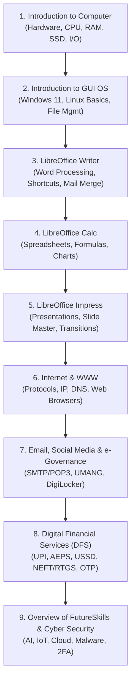

The **NIELIT CCC (Course on Computer Concepts)** certificate is arguably the most essential computer qualification in North India, especially across Uttar Pradesh. Whether you are aiming for **UP Police Computer Operator, UP Police Constable/SI, UPSSSC Lekhpal, VDO (Gram Vikas Adhikari), Junior Assistant, High Court ARO**, or State Cooperative Bank vacancies, having a valid CCC certificate is an absolute mandatory eligibility requirement.

Yet, every month, thousands of candidates fail the online exam simply because they rely on outdated guidebooks from 2018 or don't know the exact weightage of LibreOffice and Digital Financial Services.

In this definitive 2026 guide, **Er. Sumit Kumar**, founder of MSK Institute, breaks down the complete updated syllabus, exam pattern, passing marks, and provides direct access to our **Free 100-Question Online CCC Mock Test**.

---

> 🚀 **Take the Official Online CCC Mock Test (Free):**  
> Practice on authentic CCC exam-style questions with instant scoring and explanation right on your phone or PC:  
> 👉 **[Start Free NIELIT CCC Mock Test (100 Questions, 90 Mins)](/mock-test/ccc)**

---

## 1. NIELIT CCC Exam Pattern at a Glance (2026)

| Parameter | Details |
| :--- | :--- |
| **Exam Conducting Body** | NIELIT (National Institute of Electronics & Information Technology) |
| **Total Number of Questions** | **100 Questions** (Objective MCQs + True/False) |
| **Total Duration** | **90 Minutes** (approx. 54 seconds per question) |
| **Total Marks** | **100 Marks** (1 mark per correct answer) |
| **Negative Marking** | **NO NEGATIVE MARKING (0 Marks Deducted)** |
| **Exam Mode** | Online Computer-Based Test (CBT) |
| **Minimum Passing Score** | **50% (50 Marks out of 100)** |

> 💡 **Golden Exam Strategy:** Because there is **zero negative marking**, you must attempt every single question out of 100. If you are unsure of an answer, eliminate the most unlikely options and make your best calculated guess.

---

## 2. NIELIT CCC Passing Marks & Grading Scale

Your CCC certificate mentions your grade rather than percentage marks. Here is the official NIELIT grading breakdown:

| Grade | Marks Scored (Out of 100) | Performance Level |
| :--- | :--- | :--- |
| **Grade S** | **85% and Above** | Outstanding / Super |
| **Grade A** | **75% to 84%** | Excellent |
| **Grade B** | **65% to 74%** | Very Good |
| **Grade C** | **55% to 64%** | Good |
| **Grade D** | **50% to 54%** | Satisfactory (Passing Grade) |
| **Failed (F)** | Below 50% | Needs Re-attempt |

---

## 3. Updated 9-Chapter Detailed Syllabus Breakdown

The latest NIELIT CCC curriculum is divided into 9 practical chapters. Pay special attention to LibreOffice shortcuts and Digital Finance, which account for over 50% of the exam:

### High-Scoring Topics You Must Master:
1. **LibreOffice Shortcuts:**
   - `Ctrl + F12` → Insert Table in Writer.
   - `Ctrl + Shift + F9` → Recalculate formulas in Calc.
   - `F5` → Start Slide Show in Impress.
   - `Ctrl + Q` → Exit LibreOffice.
2. **Digital Financial Tools (DFS):**
   - **AEPS (Aadhaar Enabled Payment System):** Requires Aadhaar number + Biometrics; no debit card or PIN needed.
   - **USSD Code (`*99#`):** Mobile banking for feature phones without internet connection.
   - **UPI (Unified Payments Interface):** Managed by NPCI; PIN is only required to *send* money, never to *receive* money.
   - **NEFT vs RTGS:** RTGS is for minimum ₹2 Lakhs; NEFT has no minimum limit.
3. **e-Governance Services:**
   - **DigiLocker:** Authorized repository for Aadhaar, driving licenses, and academic marksheets.
   - **UMANG App:** Unified platform for PAN, EPF, and passport services.

---

## CCC परीक्षा पहले प्रयास में Grade A से कैसे पास करें? (Hindi Guide)

उत्तर प्रदेश के लाखों छात्र हर महीने CCC की परीक्षा देते हैं, लेकिन कई छात्र बिना सही तैयारी के केवल गाइड की थ्योरी पढ़कर चले जाते हैं और फेल हो जाते हैं। 

यदि आप पहले ही प्रयास में **Grade A या S** पाना चाहते हैं, तो इन 4 नियमों का पालन करें:

1. **कंप्यूटर पर प्रैक्टिकल अभ्यास करें:** सिर्फ किताबों से याद करने के बजाय LibreOffice Writer और Calc में खुद टाइपिंग और फार्मूला चलाकर देखें। जो छात्र MSK Institute की लैब में प्रैक्टिकल अभ्यास करते हैं, उनका रिजल्ट 100% रहता है।
2. **शॉर्टकट कीज़ का चार्ट बनाएं:** कम से कम 20-25 प्रश्न सीधे कीबोर्ड शॉर्टकट कीज से पूछे जाते हैं।
3. **रोजाना 100 प्रश्नों का ऑनलाइन मॉक टेस्ट दें:** परीक्षा हॉल के कंप्यूटर स्क्रीन पर समय का तनाव होता है। हमारे [ऑनलाइन CCC मॉक टेस्ट](/mock-test/ccc) को 90 मिनट के टाइमर के साथ हल करने की आदत डालें।
4. **ट्रू/फॉल्स (True/False) प्रश्नों को ध्यान से पढ़ें:** लगभग 30 से 40 प्रश्न सत्य/असत्य के आते हैं। कई बार सवाल में "नहीं" (Not) शब्द छिपा होता है, जिसे जल्दबाजी में छात्र गलत कर बैठते हैं।

---

## Summary & Your Next Step

Whether you are preparing for UP Police recruitment, state government competitive exams, or need private office job eligibility, clearing CCC is your gateway to success.

- **Practice 100 Questions Online Right Now:**  
  👉 **[Take the Free NIELIT CCC Mock Test](/mock-test/ccc)**

- **Enroll in MSK Institute's CCC Offline Crash Batch:**  
  Join our high-success batch in Shikohabad with dedicated daily lab practice, 500+ solved question banks, and 1-on-1 instructor guidance:  
  👉 **[Explore CCC Course Details](/courses/ccc)**  
  👉 **[Book a Free In-Person Demo Class](/book-demo)**
