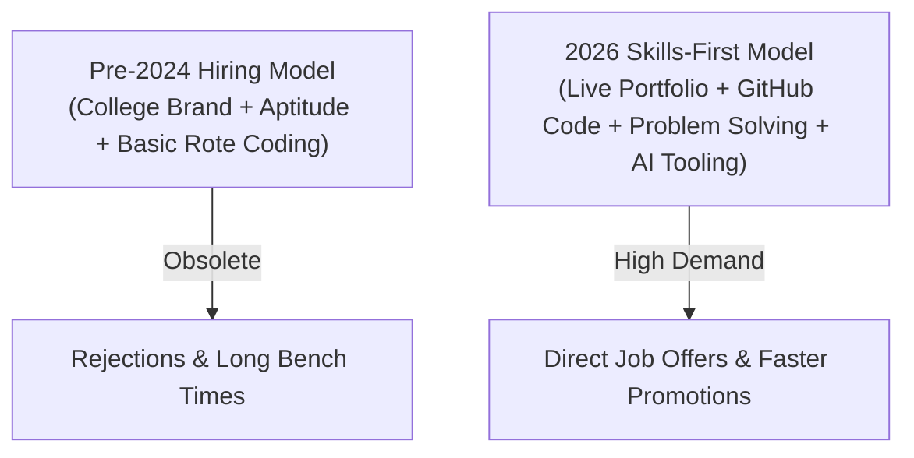

The Indian tech landscape is undergoing its most dramatic transformation since the dot-com boom. At the start of 2026, industry reports indicated that **active entry-level software openings in India dropped by nearly 24% year-on-year**. Headlines scream that tools like Claude, Gemini, ChatGPT, and AI coding agents are writing software faster than human interns.

If you are a college fresher, engineering graduate, BCA/MCA student, or a diploma holder in Uttar Pradesh or across India, you are probably asking yourself:

> *"Is software engineering dead for freshers? Should I still learn to code in 2026?"*

The short answer is **No, software engineering is not dying—it is fundamentally transforming.** What is dying is the era of the **"syntax regurgitator"**—someone who only memorizes bubble sort or copies boilerplate HTML/CSS templates. What is thriving is the **"problem-solving software craftsman"** who uses AI tools as a 10x superpower to build real-world systems.

Here is an honest, data-backed analysis by **Er. Sumit Kumar**, founder of MSK Institute, on what is actually happening in the Indian IT market and what you must learn right now to guarantee job security and high pay in 2026.

---

## The Reality Check: What AI Is Actually Replacing

AI coding tools are phenomenal at repetitive, low-complexity tasks:
1. **Generating boilerplate code:** Writing standard CRUD models, basic form validation, and repetitive REST endpoints.
2. **Simple syntax translation:** Converting a JavaScript function to Python or writing regex patterns.
3. **Basic unit test cases:** Auto-generating standard test assertions for known functions.
4. **Surface-level HTML/CSS:** Laying out simple static landing page templates.

### What AI Still Cannot Do:
- **Architecting scalable databases:** Choosing between relational and document databases, setting up indexing strategies, and preventing locking deadlocks.
- **Deep production debugging:** Tracing an intermittent race condition across asynchronous microservices.
- **Understanding business context:** Talking to an Indian retail business owner in Firozabad or Agra, understanding their inventory leaks, and translating that into software workflows.
- **Data integrity & security auditing:** Ensuring user data complies with Indian DPDP (Digital Personal Data Protection) laws and preventing API authorization bypasses.

Recruiters at top GCCs (Global Capability Centers), Indian tech giants, and funded startups aren't hiring programmers to type lines of code; **they are hiring engineers to solve business problems and make systems reliable.**

---

## The Big Shift: Skills & Proven Proof Beat College Degrees

Until 2022, many mass recruiters hired thousands of students based primarily on college placement criteria and aptitude tests. In 2026, companies are strictly **skills-first**:

Even if you graduated from a tier-3 college in Shikohabad, Agra, Lucknow, or anywhere in rural India, **your GitHub repositories, live deployed web applications, and data dashboards speak louder than any college degree**.

---

## 4 Core Skills Every Fresher Must Master in 2026

To stay ahead of AI disruption, focus your learning on these 4 pillars:

### 1. Python as Your Core Foundation
Python is the native language of the modern tech stack. Whether you venture into Artificial Intelligence, Data Analytics, backend web engineering, or cyber security, Python gives you instant access to:
- Production-grade backend APIs with **Django** or **FastAPI**.
- Data manipulation with **Pandas** and **NumPy**.
- LLM and AI agent orchestration with the **Google Gemini SDK**, **LangChain**, and **OpenAI API**.

Test your Python code directly in our [MSK Code Playground](/playground) right in your browser without any installation!

### 2. Relational Databases & Real SQL
Data is the oil that powers AI. AI cannot generate insights without clean, indexed databases. Every fresher must master:
- Relational schema design (1NF, 2NF, 3NF, Foreign Keys).
- Complex joins, Common Table Expressions (`WITH` CTEs), and Window Functions (`ROW_NUMBER()`, `DENSE_RANK()`).
- Database performance indexing and transactions (`ACID` compliance).

### 3. Business Analytics & Data Storytelling
Companies don't just need code; they need actionable numbers. Combining **Excel + SQL + Power BI** allows you to answer executive questions like: *"Which marketing campaign generated the lowest customer acquisition cost this quarter?"*

Data analysts in India command ₹5 LPA to ₹15 LPA because they directly drive executive decision-making.

### 4. AI-Augmented Software Craftsmanship
Don't fear AI—master it. In your technical interviews, show recruiters that you know how to:
- Use AI coding assistants (like Cursor, Gemini, Claude) to brainstorm architectures and spot edge-case bugs.
- Write robust test suites that verify AI-generated logic.
- Fact-check and benchmark every automated snippet before shipping to production.

---

## Not Sure Which Path Fits You? Take the Career Finder Quiz

Every student has different strengths: some love visual design and user interfaces, others love mathematical logic and analytics, and some prefer security and system administration.

Before spending money on random courses, take our free 2-minute diagnostic tool:

> 🎯 **[Take the Free MSK Career Finder Quiz Now](/career-finder)**  
> Answer 5 simple questions about your interests and education to receive your personalized 2026 tech learning roadmap instantly!

---

## Recommended Next Steps: Join Upcoming Batches

At **MSK Institute**, we don't teach from obsolete slides. Every student works on an individual workstation in our dedicated computer lab with 1-on-1 mentor guidance from software veterans.

1. **Python Mastery Batch (Starts 1 Nov):**  
   From beginner syntax to building automated applications, REST APIs, and data scripts.  
   👉 **[Explore Python Mastery Course Syllabus](/courses/python-mastery)**

2. **Data Analysis Mastery Combo Program:**  
   Master Excel, SQL, Power BI, and Python with 10+ real-world enterprise business case studies.  
   👉 **[Explore 12-Month Data Analysis Program](/courses/data-analysis-mastery-combo-course--12-months)**

3. **Check Live Schedule & Demo Seats:**  
   Browse the latest interactive cohorts and timings at our **[Live Batches Portal](/live-batches)** or **[Book a Free In-Person Demo Class](/book-demo)** at our campus in Shikohabad today!
