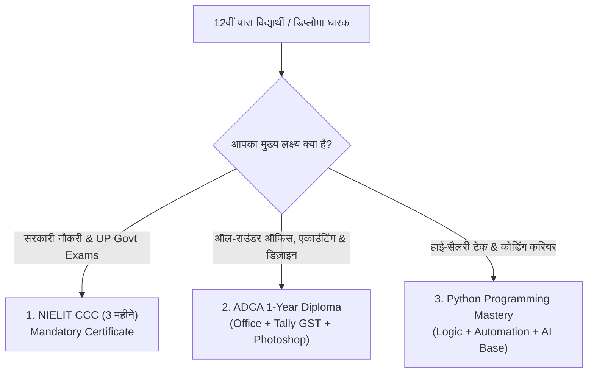

For decades, Indian society pushed a singular narrative: *"If you want a respectable job in the IT sector, you must spend 4 years and lakhs of rupees obtaining a B.Tech or BCA degree."*

In 2026, that traditional advice is broken.

Today, thousands of college graduates with expensive degrees struggle to clear basic technical interview rounds, while 18-to-20-year-olds with **practical lab skills, verifiable diploma certifications, and hands-on software fluency** are getting hired as Junior Developers, MIS Executives, Tally GST Accountants, and Digital Technicians.

Across Indian startups, digital agencies, IT service firms, and MSMEs (Micro, Small & Medium Enterprises), recruiters have adopted a pragmatic mantra:

> **"Show me what you can build, operate, and troubleshoot on a computer. Your degree is secondary."**

If you have just completed your 12th (Arts, Commerce, or Science) or a Polytechnic Diploma in Uttar Pradesh or across India, here is everything you need to know to launch an early, high-earning computer career.

---

## The Big Shift: Why Indian Companies Value Practical Skills Over Degrees

1. **Immediate Job Readiness:** Companies cannot afford to pay freshers a salary while training them for 6 months on basic office tools or coding. They want people who can generate invoices in Tally Prime, fix Excel formulas, or write Python scripts from day one.
2. **Standardized Online Testing:** Most technical hiring now begins with practical online assessments and code tests rather than resume screening.
3. **AI Tools Level the Field:** Young learners who understand how to use modern computer tools and AI assistants work twice as fast as older traditional professionals.

---

## Top 5 High-Demand Entry-Level IT Roles After 12th or Diploma

| Job Profile | Core Skills Needed | Starting Salary (Monthly) | Top Next Step |
| :--- | :--- | :--- | :--- |
| **Junior Python Developer** | Python, OOP, File Handling, SQL | **₹20,000 – ₹35,000+** | Backend Engineer |
| **Tally Prime & GST Accountant** | Tally, GST Filing, Excel, Invoicing | **₹18,000 – ₹30,000** | Senior Tax Consultant |
| **MIS & Excel Data Executive** | Advanced Excel, XLOOKUP, Pivot | **₹18,000 – ₹28,000** | Data Analyst |
| **Graphic & DTP Designer** | Photoshop, CorelDraw, Vector Art | **₹16,000 – ₹25,000** | UI/UX Designer |
| **Govt / Private Computer Operator** | CCC Certificate, Typing, Windows OS | **₹15,000 – ₹24,000** | Office Superintendent |

---

## 12वीं के बाद कौन सा कंप्यूटर कोर्स करें? (Complete Guide in Hindi)

यदि आपने हाल ही में 12वीं (Arts, Commerce, या Science) की परीक्षा पास की है या कोई डिप्लोमा किया है, तो आपके मन में सबसे बड़ा सवाल यह होता है कि **कम समय और कम फीस में ऐसा कौन सा कंप्यूटर कोर्स करें जिससे तुरंत नौकरी या फ्रीलांसिंग शुरू हो सके?**

यहाँ MSK Institute द्वारा सुझाए गए 3 सबसे बेहतरीन और रोजगारपरक कंप्यूटर कोर्सेज की विस्तृत जानकारी दी गई है:

---

### विकल्प 1: ADCA (Advance Diploma in Computer Applications) – 1 Year Diploma
अगर आप एक ही कोर्स में कंप्यूटर की पूरी दुनिया सीखना चाहते हैं, तो **[ADCA (1-Year Diploma)](/courses/adca)** भारत का सबसे लोकप्रिय और भरोसेमंद डिप्लोमा है।

- **क्या सीखते हैं:** कंप्यूटर फंडामेंटल्स, विंडोज 11, एडवांस्ड MS Office (Word, Excel, PowerPoint), Tally Prime के साथ पूरा GST एकाउंटिंग, CorelDraw और Photoshop में ग्राफिक्स डिज़ाइन, और HTML वेब डिज़ाइन।
- **किसके लिए बेस्ट है:** 12वीं पास छात्र जो प्राइवेट कंपनी में एकाउंटेंट, ऑफिस एडमिन, या डेटा ऑपरेटर बनना चाहते हैं।
- **सर्टिफिकेट मान्यता:** सरकारी एवं प्राइवेट नौकरियों के 1-वर्षीय कंप्यूटर डिप्लोमा नियम के तहत पूरी तरह मान्य। (MSK Institute के सभी सर्टिफिकेट्स में [ऑनलाइन QR-Code वेरिफिकेशन](/verify-certificate) उपलब्ध है)।

👉 **[ADCA कोर्स का पूरा सिलेबस और फीस देखें](/courses/adca)**

---

### विकल्प 2: NIELIT CCC (Course on Computer Concepts) – सरकारी नौकरी अनिवार्य
यदि आप उत्तर प्रदेश पुलिस (UP Police Computer Operator / Constable / SI), लेखपाल, VDO, या जूनियर असिस्टेंट जैसी सरकारी भर्तियों की तैयारी कर रहे हैं, तो **[NIELIT CCC](/courses/ccc)** सर्टिफिकेट होना अनिवार्य है।

- **अवधि:** 2 से 3 महीने।
- **सिलेबस:** LibreOffice (Writer, Calc, Impress), इंटरनेट प्रोटोकॉल्स, साइबर सिक्योरिटी, और डिजिटल फाइनेंस (UPI, AEPS)।
- **फ्री मॉक टेस्ट:** आप हमारी वेबसाइट पर घर बैठे बिना किसी शुल्क के असली परीक्षा जैसे 100 प्रश्नों का [फ्री NIELIT CCC मॉक टेस्ट](/mock-test/ccc) दे सकते हैं।

👉 **[फ्री ऑनलाइन CCC मॉक टेस्ट देकर अपनी तैयारी जांचें](/mock-test/ccc)**

---

### विकल्प 3: Python Programming Mastery – कोडिंग व सॉफ्टवेयर करियर
यदि आप कंप्यूटर साइंस, वेबसाइट्स और AI की दुनिया में कदम रखना चाहते हैं, तो 12वीं के बाद ही पाइथन सीखना आपके करियर का सबसे बेहतरीन फैसला होगा।

- **अवधि:** 3 महीने।
- **क्या सीखते हैं:** प्रोग्रामिंग लॉजिक, डेटा स्ट्रक्चर्स, ऑटोमेशन स्क्रिप्ट्स, और डेटाबेस कनेक्शन।
- **फायदा:** 12वीं के बाद से ही आप फ्रीलांसिंग प्रोजेक्ट्स कर सकते हैं या सॉफ्टवेयर कंपनियों में इंटर्नशिप पा सकते हैं।

👉 **[पाइथन मास्टरी बैच (Starts 1 Nov) का सिलेबस देखें](/courses/python-mastery-beginner-to-advanced--3-months)**

---

## 3 Golden Rules for 12th Pass Students Before Joining Any Course

1. **Verify Lab Quality:** Never join a center where 3 students share 1 desktop. You need **1 dedicated computer per student** for daily hands-on practice.
2. **Insist on Verifiable Certificates:** Ensure that your certificate has a unique serial number and QR code that can be verified online 24/7 by employers (check [MSK Certificate Verification](/verify-certificate)).
3. **Practice English & Hindi Typing:** Fast typing speed (30+ WPM) doubles your chances of landing government and private office roles. Practice daily using our free [Online Typing Tool](/tools/typing).

---

## Summary & How to Get Started at MSK Institute

Your future is decided by your **skills, speed, and dedication**, not by what degree title is printed on your paper.

At **MSK Institute in Shikohabad**, our classrooms and labs are designed to give young students maximum practical confidence:
- 1 Student : 1 Dedicated Workstation with modern high-speed PCs.
- 100% Uninterrupted Power Backup (no classes canceled due to load shedding).
- 1-on-1 personalized mentorship by software engineers.
- Government-valid certifications with lifetime online verification.

👉 **[Book a Free 2-Day Demo Class at MSK Institute](/book-demo)**  
👉 **[Take the Free Career Finder Quiz to Pick Your Ideal Course](/career-finder)**  
👉 **Have questions? [Chat with our Academic Counselor on WhatsApp](https://wa.me/918393042166?text=Hello%20MSK%20Institute,%20I%20have%20passed%2012th%20and%20want%20guidance%20on%20which%20computer%20course%20to%20choose.)**
