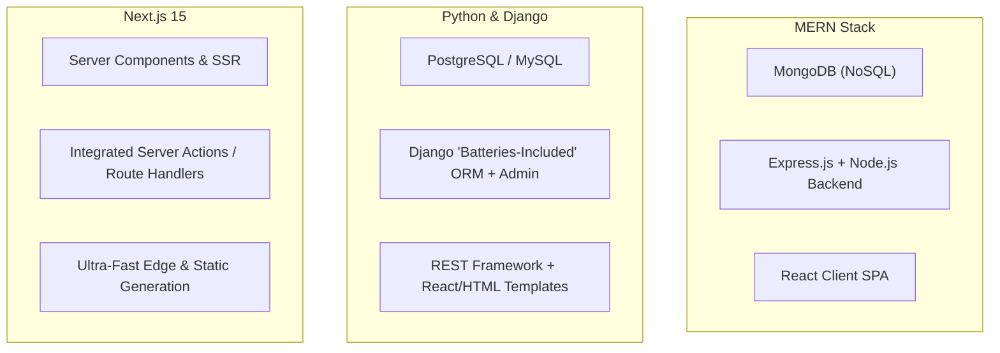

Full-stack web development remains the single most resilient and widely hired IT skill in India. Every startup, SaaS platform, business directory, and e-commerce brand requires engineers who can seamlessly design interactive frontends and connect them to secure, reliable database backends.

However, when aspiring developers begin their journey in 2026, they are immediately confronted with a bewildering choice of tech stacks:

- **MERN Stack:** MongoDB, Express.js, React.js, and Node.js.
- **Python & Django Stack:** Python, Django / Django REST Framework, and PostgreSQL/MySQL.
- **Next.js 15 Stack:** React Server Components (RSC), TypeScript, Server Actions, and Hybrid API routes.

Should you learn JavaScript across the entire stack? Or does Python's dominance in AI and data make Django the smarter long-term bet? And where does Next.js fit into the picture?

Here is an objective, practical breakdown by **Er. Sumit Kumar** at MSK Institute to help you choose the right stack for your career goals.

---

## 1. Quick Snapshot: The 3 Contenders

---

## 2. In-Depth Comparison: MERN vs Django vs Next.js

| Feature | MERN Stack | Python + Django | Next.js 15 (React Framework) |
| :--- | :--- | :--- | :--- |
| **Primary Language** | JavaScript / TypeScript | Python | TypeScript / JavaScript |
| **Philosophy** | Modular & Flexible | "Batteries-Included" & Robust | Full-Stack React Framework |
| **Database Norm** | MongoDB (NoSQL) or PostgreSQL | PostgreSQL, MySQL, SQLite | PostgreSQL, Prisma / Drizzle |
| **Admin Dashboard** | Must be coded from scratch | **Built-in Auto Admin Panel** | Custom or third-party libraries |
| **Built-in Auth & Security** | Manual JWT / bcrypt setup | **Built-in CSRF, Auth & Permissions** | NextAuth / Clerk / Custom Auth |
| **AI & ML Integration** | Good (Node SDKs) | **Superior (Native PyTorch/Pandas)** | Excellent (Vercel AI SDK) |
| **SEO Performance** | Requires extra SSR setup | Excellent (Server-Rendered) | **World-Class (Built-in SSR/SSG)** |
| **Hiring Demand in India** | ⭐⭐⭐⭐⭐ (Massive Startups & MNCs) | ⭐⭐⭐⭐ (Fintech, AI, Enterprise) | ⭐⭐⭐⭐⭐ (Modern Product Teams) |

---

## 3. Deep-Dive into Each Stack

### Contender A: The MERN Stack (The Startup Workhorse)
MERN has been India's most popular full-stack choice for over 6 years because **you only need to learn one programming language: JavaScript**.
- **Pros:**
  - One language across frontend, backend, and database queries.
  - Huge npm ecosystem with millions of open-source packages.
  - Abundant job openings across early-stage startups and product agencies in Bengaluru, Gurugram, and Noida.
- **Cons:**
  - Setting up routing, authentication, file storage, and database relationships requires stitching together dozens of independent libraries.
  - Single-page React apps require careful SSR configuration for search engines to index them properly.

👉 **Best For:** Students who want to master frontend React deeply while building lightweight Node.js microservices.

---

### Contender B: Python & Django (The Enterprise & AI Powerhouse)
Django's motto is *"The web framework for perfectionists with deadlines"*. It comes with user authentication, database ORM, admin panel, CSRF protection, and email handling right out of the box.
- **Pros:**
  - **Instant Admin Portal:** You get a full-featured, secure admin dashboard in 5 minutes without writing custom UI code.
  - **Bulletproof Security:** Protects against SQL Injection, CSRF, and Clickjacking by default.
  - **Direct AI & Data Pipeline:** If your web application connects to Machine Learning models, Pandas analytics, or LLM agents, Python is the native tongue.
- **Cons:**
  - Slightly less hype on social media than JavaScript frameworks (though heavily used by Instagram, Spotify, Pinterest, and NASA).
  - Can feel monolithic for teams building micro-frontend architectures.

👉 **Best For:** Developers who want high developer productivity, robust database reliability, or plan to bridge into Data Analytics and Artificial Intelligence.

---

### Contender C: Next.js 15 (The Modern Production Gold Standard)
Next.js takes React and turns it into a complete, full-stack powerhouse. With React Server Components (RSC) and Server Actions, the boundary between client and server dissolves into a unified, high-performance experience.
- **Pros:**
  - **Instant SEO & Lighthouse Scores:** Server-side rendering (SSR) and static site generation (SSG) make your pages rank at the top of Google.
  - **Zero-Config Routing:** File-system based App Router with parallel and intercepting routes.
  - **Top Choice for Modern Tech Startups:** Global tech leaders and funded Indian SaaS companies are actively migrating existing React codebases to Next.js.
- **Cons:**
  - Higher conceptual learning curve (understanding Server vs Client component boundaries).
  - Rapid evolution means you must learn modern Next.js 14/15 patterns rather than older Pages Router tutorials.

👉 **Best For:** Developers aiming for high-paying product company roles, SaaS founders, and engineers building public SEO-driven platforms.

---

## 4. The Verdict: Which Stack Should YOU Choose?

1. **Choose Python & Django if:**  
   You love clean Python syntax, want a built-in admin panel and robust enterprise security, or want to integrate Machine Learning and Data Science down the line.  
   👉 **[Explore Full-Stack Python & Django Mastery (12 Months)](/courses/full-stack-python-mastery--12-months)**

2. **Choose MERN if:**  
   You want to master JavaScript end-to-end and build dynamic, single-page interactive web applications.  
   👉 **[Explore Full-Stack MERN Stack Mastery (12 Months)](/courses/full-stack-mern-mastery--12-months)**

3. **Choose Next.js if:**  
   You already know JavaScript/React basics and want to build lightning-fast, production-ready, SEO-optimized web platforms.  
   👉 **[Explore Next.js 15: React Framework Mastery](/courses/nextjs-complete-course)**

4. **Want to Master All Three as a Multi-Stack Architect?**  
   Our flagship 18-month diploma trains you across Python, Node.js, React, Next.js, and cloud deployment:  
   👉 **[Explore Full-Stack Web Development Grand Mastery (18 Months)](/courses/full-stack-development)**

---

## Summary & Next Steps

At **MSK Institute in Shikohabad**, we don't just teach theory—our full-stack students build and deploy 3+ live database-driven applications with custom domains, production databases, and GitHub portfolios.

Test your coding logic live on the web right now using our **[MSK Code Playground](/playground)**, or **[Book a Free Demo Class](/book-demo)** to discuss your coding ambitions with our instructors!
