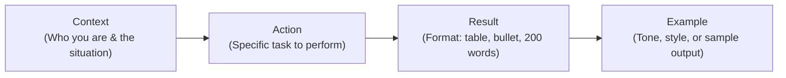

You don't need to know Python, Java, or advanced algorithms to benefit from the Artificial Intelligence revolution. In 2026, **Generative AI and Prompt Engineering are recognized as foundational digital literacy skills**—just like typing, emailing, and browsing the web were two decades ago.

School students, college graduates, competitive exam aspirants, and office workers across India are using simple, zero-coding AI tools to:
- Summarize 100-page academic PDFs in seconds.
- Create professional PowerPoint presentation decks in 2 minutes.
- Craft attractive social media posters, brochures, and resume layouts without graphic design degrees.
- Analyze Excel spreadsheets and budgets using plain conversational English.

If you are a student or non-coder looking to 10x your productivity, here are the **top 10 AI tools you should use in 2026 without writing a single line of code**, curated by **Er. Sumit Kumar** at MSK Institute.

---

## 1. ChatGPT & Claude 3.5 Sonnet (Conceptual Clarification & Writing Partner)

- **Best For:** Explaining difficult concepts in simple language, drafting letters, and creative writing.
- **Why Students Love It:** Stuck on a difficult economics theory or physics law? Tell it: *"Explain the law of diminishing marginal utility using cricket examples in simple Hinglish."* It breaks down complex ideas into everyday intuition.
- **Cost:** Free tiers available on web and mobile apps.

---

## 2. Google Gemini & NotebookLM (AI Research Assistant for Your Textbooks)

- **Best For:** Studying your exact college syllabus, lecture notes, and textbook chapters.
- **Why Students Love It:** NotebookLM allows you to upload up to 50 PDF chapters or lecture notes and creates an interactive grounded AI assistant. You can ask: *"What are the 5 questions most likely to be asked in the semester exam based on Chapter 3?"* It even generates a 2-person audio discussion podcast summarizing your notes!
- **Cost:** 100% Free with your Google account.

---

## 3. Gamma.app (Generate Full Presentation Decks in 60 Seconds)

- **Best For:** College seminar presentations, viva slide decks, and school projects.
- **Why Students Love It:** Gone are the days of spending 4 hours manually formatting PowerPoint slides. Simply type: *"Create an 8-slide presentation on Cyber Security Trends in India for 2026"*, and Gamma generates structured cards, high-resolution visuals, bullet points, and formatting automatically.
- **Cost:** Free monthly credits.

---

## 4. Perplexity AI (Academic Research with Verified Footnotes)

- **Best For:** Writing college research papers, school essays, and competitive exam GK preparation.
- **Why Students Love It:** General AI chatbots sometimes invent facts. Perplexity acts as an AI search engine that attaches **clickable live citations and references** to every claim, ensuring your seminar reports are 100% fact-checked.
- **Cost:** Free to search with real-time web citations.

---

## 5. Canva Magic Studio & Microsoft Designer (Visual Design Without Photoshop)

- **Best For:** Creating Instagram graphics, festival greetings, event banners, and college fest posters.
- **Why Students Love It:** Type: *"A minimalist modern flyer for a college coding hackathon with blue gradient"* and it generates editable vector layouts with fonts, stickers, and color harmony ready to export.

---

## 6. ChatPDF & Humata.ai (Instant Questioning of Large PDF Documents)

- **Best For:** Reading 80-page government job circulars, legal terms, and university syllabus notifications.
- **Why Students Love It:** Upload any PDF circular (e.g., UP Police or SSC exam notification) and ask: *"What is the exact age limit for general category candidates and what is the last date to apply?"* It pulls the exact clause and page number in 3 seconds.
- **Cost:** Generous free tier for regular document uploads.

---

## 7. Julius AI (Spreadsheet Analytics in Plain English)

- **Best For:** Analyzing sales numbers, personal expense sheets, and survey data without knowing complex Excel formulas.
- **Why Students Love It:** Upload a `.csv` or `.xlsx` spreadsheet and prompt: *"Show me which product had the highest sales growth this month and make a bar chart."* Julius generates instant charts and descriptive statistical summaries.
- **Cost:** Free monthly queries.

---

## 8. ElevenLabs & Otter.ai (Voice Generation & Lecture Transcription)

- **Best For:** Recording college lectures and converting spoken words into clean study notes.
- **Why Students Love It:** Record a 45-minute professor lecture, and Otter transcribes it into bulleted action items and keywords. ElevenLabs lets you generate natural, lifelike voiceovers for multimedia presentations.

---

## 9. Notion AI (Smart Study Planner & Note Organizer)

- **Best For:** Organizing semester timetables, assignment deadlines, and personal knowledge bases.
- **Why Students Love It:** Keeps all your subject notes in one linked workspace, auto-summarizes lecture notes, and turns rough bullet points into polished study guides.

---

## 10. MSK Interactive Free Learning Tools

- **Best For:** Boosting everyday computer speed and skills without installing heavy software.
- **Why Students Love It:** Built right into our institute website at **[mskinstitute.in/tools](/tools)**:
  - **[Online Hindi & English Typing Speed Tester](/tools/typing)**: Increase your typing speed for government and corporate office jobs.
  - **[Instant Code Playground](/playground)**: Test basic code snippets right in your mobile browser.

---

## Prompt Engineering 101: The CARE Formula for Non-Coders

To get 10x better answers from any AI tool, stop typing lazy one-line questions. Use the **C-A-R-E framework**:

**Bad Prompt:**  
*"Write a cover letter for data entry job."*

**CARE Prompt:**  
*"I am a 12th pass student with an ADCA diploma and 40 WPM typing speed [Context]. Write a professional cover letter for an Office Assistant role at a hospital in Agra [Action]. Keep it under 200 words in 3 short paragraphs [Result]. Maintain an enthusiastic, polite, and professional tone [Example]."*

---

## Ready to Level Up Your Computer & Tech Skills?

Using AI tools gives you an immediate productivity boost, but combining AI fluency with recognized certifications makes you unstoppable:

1. **For Complete Computer Mastery (No Coding Required):**  
   Enroll in our 1-year **[ADCA (Advance Diploma in Computer Applications)](/courses/adca)** to master Windows, MS Office, Advanced Excel, Tally Prime with GST, and Graphic Design.

2. **Ready to Transition from AI User to AI Builder?**  
   Learn to write real Python software and build automated AI applications in our beginner-friendly **[Python Programming Mastery Course](/courses/python-mastery-beginner-to-advanced--3-months)**.

3. **Visit Our Modern Computer Lab in Shikohabad:**  
   Every student gets 1 dedicated PC with high-speed internet and power backup.  
   👉 **[Book a Free In-Person Demo Class Today](/book-demo)**
